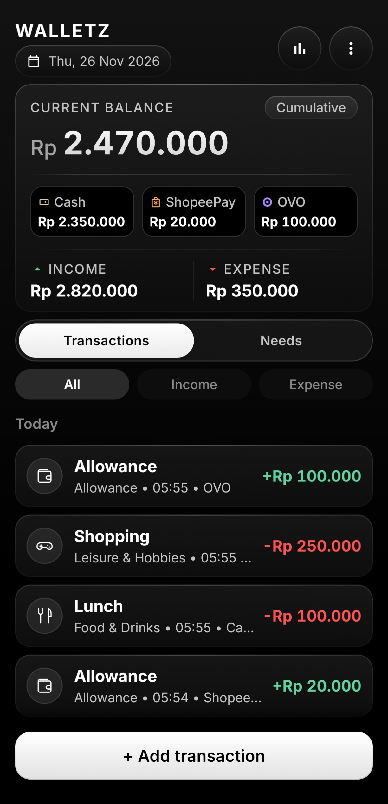
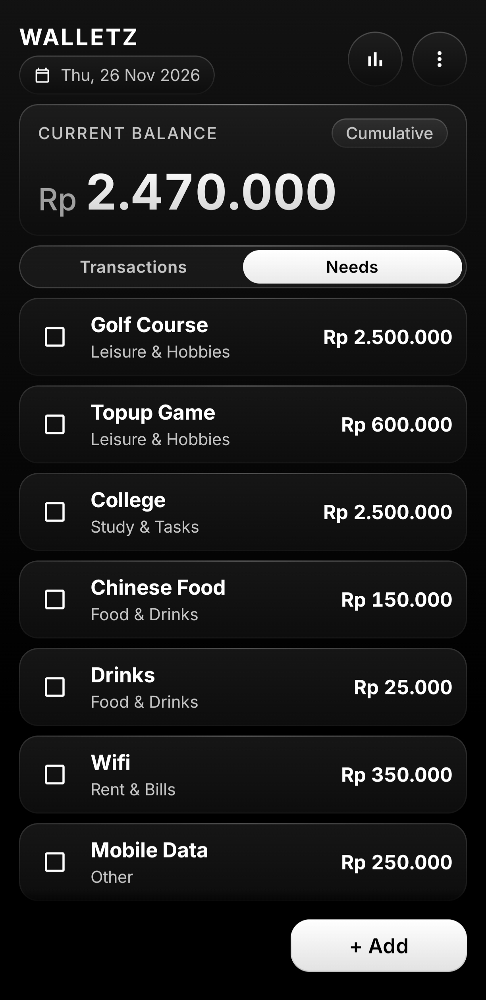
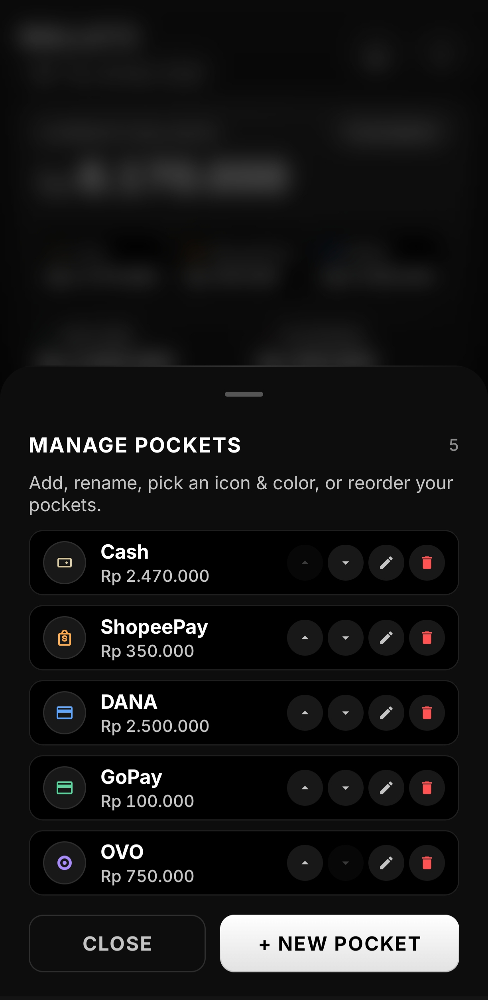

<h1>WALLETZ</h1>

<strong>Offline multi-pocket personal finance tracker for Android.</strong>

Built with Kotlin, Jetpack Compose, and Room (SQLite) for daily expense logging without accounts, cloud sync, or bank APIs.

  
  
  
  
  
  

  

 

<table>
  <tr>
    <td align="center"></td>
    <td align="center"></td>
    <td align="center"></td>
  </tr>
</table>

---

### Features

| Area | Details |
| :--- | :--- |
| **Multi-Pocket Ledger** | Manual tracking across pockets with cumulative, current-month, or specific-date filters. Starts with **Cash**, **ShopeePay**, and **OVO**; add, rename, reorder, and pick an icon/color for your own pockets (e.g. GoPay, BCA, Savings). Deleting a pocket moves its transactions to the first remaining pocket. |
| **Monochrome OLED UI** | Deep OLED dark background, tabular odometer digits, tap-to-mask balances, and two-stage scroll-collapsing header. |
| **Transfers & Recurring** | Pocket-to-pocket transfers, manual balance adjustments, and `Daily` / `Weekly` / `Monthly` recurring schedules. |
| **Needs & Swipe Actions** | Planned expense checklist that auto-logs when checked off, plus swipe-to-delete with confirmation and undo. |
| **Category Summary** | Donut chart and per-category breakdown excluding internal transfers and balance adjustments. |
| **CSV Export & Import** | Multi-section UTF-8 CSV backup with formula sanitization and automatic local pre-import snapshots. |

---

### Privacy & Local Storage

No `INTERNET` permission is declared in `AndroidManifest.xml` — records stay in local SQLite storage unless exported manually. 
Blacks out the Recent Apps preview (Android 13+ and on pause) and excludes the database and internal auto-backup CSVs from cloud backups. Regular screenshots are still allowed.

---

All Rights Reserved · Built with Kotlin, Jetpack Compose & Room · Typeface: <a href="third_party/Inter-LICENSE.txt">Inter (OFL-1.1)</a>

